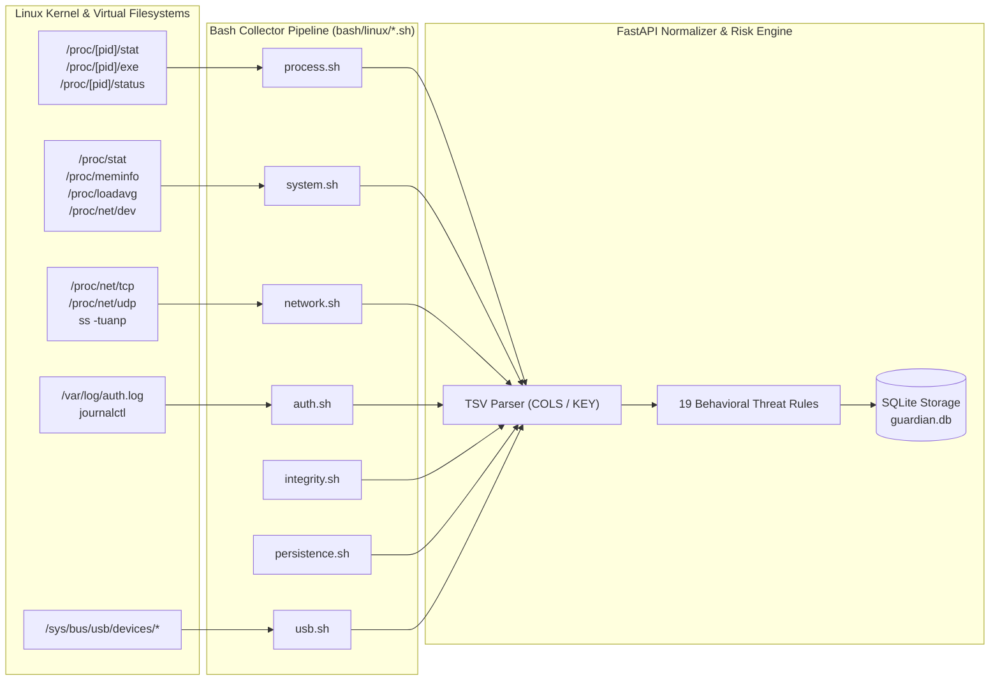

# 🛡️ SMART OS GUARDIAN PRO v6.0

```text
  ███████╗███╗   ███╗ █████╗ ██████╗ ████████╗     ██████╗ ███████╗    ██████╗ ██╗   ██╗ █████╗ ██████╗ ██████╗ ██╗ █████╗ ███╗   ██╗
  ██╔════╝████╗ ████║██╔══██╗██╔══██╗╚══██╔══╝    ██╔═══██╗██╔════╝   ██╔════╝ ██║   ██║██╔══██╗██╔══██╗██╔══██╗██║██╔══██╗████╗  ██║
  ███████╗██╔████╔██║███████║██████╔╝   ██║       ██║   ██║███████╗   ██║  ███╗██║   ██║███████║██████╔╝██║  ██║██║███████║██╔██╗ ██║
  ╚════██║██║╚██╔╝██║██╔══██║██╔══██╗   ██║       ██║   ██║╚════██║   ██║   ██║██║   ██║██╔══██║██╔══██╗██║  ██║██║██╔══██║██║╚██╗██║
  ███████║██║ └──═╝██║██║  ██║██║  ██║   ██║       ╚██████╔╝███████║   ╚██████╔╝╚██████╔╝██║  ██║██║  ██║██████╔╝██║██║  ██║██║ ╚████║
  ╚══════╝╚═╝     ╚═╝╚═╝  ╚═╝╚═╝  ╚═╝   ╚═╝        ╚═════╝ ╚══════╝    ╚═════╝  ╚═════╝ ╚═╝  ╚═╝╚═╝  ╚═╝╚═════╝ ╚═╝╚═╝  ╚═╝╚═╝  ╚═══╝
```

<p align="center">
  <b>Next-Generation Real-Time Host Intrusion Detection System (HIDS) & Security Operations Center (SOC)</b><br>
  <i>Powered by Native Linux Bash Kernel Collectors, Windows PowerShell Bridge, FastAPI, SQLite & React 18 3D Cyber UI</i>
</p>

<p align="center">
  
  
  
  
  
  
  
</p>

---

## 📑 Table of Contents
- [Executive Overview](#-executive-overview)
- [Key Core Capabilities](#-key-core-capabilities)
- [Linux Kernel Interfaces & Bash Collectors Specification](#-linux-kernel-interfaces--bash-collectors-specification)
  - [1. Process Forensics & Memory Inspection (`process.sh`)](#1-process-forensics--memory-inspection-processsh)
  - [2. Hardware Sentinel & System Telemetry (`system.sh`)](#2-hardware-sentinel--system-telemetry-systemsh)
  - [3. Network Socket Auditing & Protocol Geometry (`network.sh`)](#3-network-socket-auditing--protocol-geometry-networksh)
  - [4. Cryptographic File Vault (`integrity.sh`)](#4-cryptographic-file-vault-integritysh)
  - [5. Persistence & Rootkit Auditing (`persistence.sh`)](#5-persistence--rootkit-auditing-persistencesh)
  - [6. Authentication & Privilege Escalation (`auth.sh`)](#6-authentication--privilege-escalation-authsh)
  - [7. Hardware & USB Bus Monitor (`usb.sh`)](#7-hardware--usb-bus-monitor-usbsh)
- [Unified Hybrid Defense Architecture (`Both Mode`)](#-unified-hybrid-defense-architecture-both-mode)
- [3D Cyber UI & Command Center](#-3d-cyber-ui--command-center)
- [Quick Start Guide](#-quick-start-guide)
- [Automated Testing & Verification](#-automated-testing--verification)
- [Academic Defense & Viva Presentation Checklist](#-academic-defense--viva-presentation-checklist)

---

## 📌 Executive Overview

**Smart OS Guardian** is an enterprise-grade Host Intrusion Detection System (HIDS) and Security Operations Dashboard built specifically to demonstrate **100% genuine operating system telemetry without mock data**.

Unlike simulated academic projects, Smart OS Guardian executes directly against real host kernels:
- **Zero Mock Data Guarantee**: Every process, open port, SSH attempt, SUID binary, and CPU core spike originates from actual kernel syscalls and virtual filesystems.
- **Micro-Footprint Read-Only Collectors**: Collectors run in strictly non-destructive read-only mode, parsing `/proc`, `/sys`, `/var/log`, and system binaries.
- **Unified Both Hybrid Defense**: Simultaneously inspects Linux and Windows environments side-by-side on hybrid developer workstations.

---

## 🚀 Key Core Capabilities

| Capability | Technical Implementation | Security Value |
| :--- | :--- | :--- |
| **3D Cyber Command Center** | Perspective 3D isometric cards, Holographic Risk Gauge, 6-Vector Sentinel Matrix | Instant situational awareness for SOC operators |
| **Live Hardware Telemetry** | WebSockets streaming sub-second differential `/proc/stat` and RAM/Disk I/O | Real-time spike detection and anomaly correlation |
| **In-Memory Malware Detection** | Broken symlink inspection on `/proc/[pid]/exe` (`(deleted)`) | Catches evasive malware executing after binary unlinking |
| **Shell Drop / Temp Execution** | Path validation catching execution out of `/tmp` or `/dev/shm` | Thwarts unauthorized staging script execution |
| **Backdoor Port Radar** | Hex IP conversion, registered port classification, baseline diffing | Detects reverse shells and unauthorized listeners |
| **Privilege Escalation Guard** | Real-time parsing of `/etc/passwd` UID 0 accounts, SUID files, world-writable configs | Mitigates local privilege escalation (LPE) vulnerabilities |
| **Cryptographic Integrity Vault** | Multi-file SHA-256 baseline tracking for sensitive system configs | Immediate alert on configuration tampering |
| **Built-in Native Terminal** | Sandboxed xterm.js terminal with dual OS execution (`whoami`, `ss`, `guardian status`) | Native forensic investigation directly in-browser |

---

## 🐧 Linux Kernel Interfaces & Bash Collectors Specification

The heartbeat of Smart OS Guardian is its collection of pure Bash scripts located in `bash/linux/*.sh`. Each script adheres to POSIX/Bash best practices (`set -u`, shared `lib.sh` formatting, error trapping) and outputs structured Tab-Separated Values (TSV) directly to standard output.



---

### 1. Process Forensics & Memory Inspection (`process.sh`)
- **Kernel Endpoints**: `/proc/[0-9]*/stat`, `/proc/[0-9]*/comm`, `/proc/[0-9]*/status`, `/proc/[0-9]*/exe`
- **Linux Tools**: `nproc`, `readlink`, `awk`, `cat`, `sleep`
- **Differential CPU Sampling Algorithm**:
  Bash samples `utime + stime` across all running PIDs twice with a strict $0.5\text{s}$ interval:
  $$\Delta t_{\text{cpu}} = \text{total\_time}_2 - \text{total\_time}_1$$
  $$\text{Proc\_CPU}\% = \frac{100 \times N_{\text{cores}} \times (\text{jiffies}_2 - \text{jiffies}_1)}{\Delta t_{\text{cpu}}}$$
- **Threat Flags Detected**:
  - `deleted_binary`: Detected via `readlink /proc/$pid/exe` matching `*"(deleted)"`. Detects malware running exclusively in RAM after unlinking its on-disk binary.
  - `tmp_exec`: Detected if the executable target resides in `/tmp/*` or `/dev/shm/*` (common staging directories for memory-only exploits).

```bash
# Core logic snippet from bash/linux/process.sh
exe=$(readlink "$d/exe" 2>/dev/null); flag=ok
case "$exe" in
  *"(deleted)") flag=deleted_binary;;
  /tmp/*|/dev/shm/*) flag=tmp_exec;;
esac
emit linux "$pid" "${ppid:-0}" "${uid:-0}" "$name" "${exe:--}" "${cpu[$pid]:-0.0}" "${mem:-0}" "$flag"
```

---

### 2. Hardware Sentinel & System Telemetry (`system.sh`)
- **Kernel Endpoints**: 
  - `/proc/stat`: Aggregate CPU state counters (`user`, `nice`, `system`, `idle`, `iowait`, `irq`, `softirq`).
  - `/proc/meminfo`: Queries `MemTotal` and `MemAvailable` to compute true instantaneous RAM utilization.
  - `/proc/loadavg`: 1-minute, 5-minute, and 15-minute kernel run-queue averages.
  - `/proc/uptime`: System uptime in fractional seconds.
  - `/proc/net/dev`: Hardware network interface byte counters, excluding `lo` loopback.
- **Linux Tools**: `awk`, `df /`, `cut`

$$\text{RAM Utilization}\% = 100 \times \left(1 - \frac{\text{MemAvailable}}{\text{MemTotal}}\right)$$

---

### 3. Network Socket Auditing & Protocol Geometry (`network.sh`)
- **Kernel Endpoints & Commands**:
  - Primary: `ss -H -tuanp` (Kernel socket statistics with process names).
  - Fallback: Direct hex decoding of `/proc/net/tcp`, `/proc/net/tcp6`, `/proc/net/udp`, `/proc/net/udp6`.
- **IP Address Hex Decoding in Bash**:
  `/proc/net/tcp` stores IPv4 in little-endian hex format (e.g., `0100007F:0016` $\to$ `127.0.0.1:22`). `network.sh` decodes this with zero external binaries:
  ```bash
  hexip() { printf '%d.%d.%d.%d' "0x${1:6:2}" "0x${1:4:2}" "0x${1:2:2}" "0x${1:0:2}"; }
  ```
- **State Filtering**: Maps raw socket states (`0A` = LISTEN, `01` = ESTABLISHED) and extracts owning process names.

---

### 4. Cryptographic File Vault (`integrity.sh`)
- **Monitored Locations**: Configured via `bash/common/watchlist.conf` and user overrides (`data/watchlist.user.conf`):
  - `/etc/passwd`, `/etc/shadow`, `/etc/sudoers`, `/etc/hosts`, `/etc/resolv.conf`, `~/.ssh/authorized_keys`, etc.
- **Linux Tools**: `compgen -G` (wildcard expansion), `stat -c %s` (file size validation $\le 5\text{ MB}$), `sha256sum`, `cut`, `sort -u`.
- **Security Check**: Enforces file presence and maximum size bounds before calculating cryptographic hashes to prevent Denial of Service (DoS) on large binary files.

---

### 5. Persistence & Rootkit Auditing (`persistence.sh`)
Inspects 7 distinct persistence vectors used by advanced persistent threats (APTs):
1. **User Crontabs**: `crontab -l 2>/dev/null | grep -v '^#'`
2. **System Cron Directories**: `/etc/cron.d/*`, `/etc/cron.daily/*`, `/etc/crontab`
3. **Systemd Unit Files**: `/etc/systemd/system/*.service`
4. **SSH Authorized Keys**: `~/.ssh/authorized_keys`
5. **Shell Startup Files**: `~/.bashrc`, `~/.profile`, `/etc/profile`, `/etc/bash.bashrc`
6. **Rogue User Accounts**: `awk -F: '$3==0 || $3>=1000 {print $0}' /etc/passwd` (Detects hidden UID 0 root users).
7. **SUID Root Binaries & World-Writable Files**:
   - `find ... -perm -4000` (Catches rogue binaries with root execution bits set).
   - `find ... -perm -0002` (Catches dangerous world-writable configuration files).

---

### 6. Authentication & Privilege Escalation (`auth.sh`)
- **Active Sessions**: `who` (Terminal, username, TTY, login time).
- **Session History**: `last -w -i -F -n 100` (Parses `/var/log/wtmp` with timestamps and remote IPs).
- **Log Stream Analysis**:
  - Reads `/var/log/auth.log` if readable, otherwise automatically falls back to:
    ```bash
    journalctl --no-pager -o short -n 3000 _COMM=sshd _COMM=sudo _COMM=su
    ```
- **Event Classification via AWK**:
  - **SSH Brute-Force**: Matches `Failed password for [invalid] <user> from <ip>`.
  - **SSH Success**: Matches `Accepted password/publickey for <user> from <ip>`.
  - **Sudo Command Execution**: Extracts user and target command (`COMMAND=...`).
  - **Privilege Escalation**: Extracts `su: session opened for user root by <user>`.

---

### 7. Hardware & USB Bus Monitor (`usb.sh`)
- **Kernel Sysfs Path**: `/sys/bus/usb/devices/*`
- **Extracted Attributes**:
  - `idVendor`: USB Vendor Identification number.
  - `idProduct`: USB Product Identification number.
  - `product`: Device string description (e.g., `SanDisk Ultra`, `Rubber Ducky`).
  - `serial`: Hardware serial number.

---

## 🌐 Unified Hybrid Defense Architecture (`Both Mode`)

On modern engineering machines, developers frequently run Windows with WSL2 Linux sub-environments. Smart OS Guardian introduces a native **Unified Hybrid Defense**:

```text
┌────────────────────────────────────────────────────────────────────────┐
│                        Smart OS Guardian PRO v6.0                      │
│            [SOURCE: LINUX]      [SOURCE: WINDOWS]      [UNIFIED BOTH]   │
└───────────────────────────────────┬────────────────────────────────────┘
                                    │
           ┌────────────────────────┴────────────────────────┐
           ▼                                                 ▼
┌─────────────────────────────┐                   ┌─────────────────────────────┐
│    Linux Engine (Bash)      │                   │   Windows Bridge (Posh)     │
│  • /proc/stat CPU Delta     │                   │  • Get-CimInstance (OS)     │
│  • ss -tuanp Network        │                   │  • Get-NetTCPConnection     │
│  • /proc/[pid]/exe deleted  │                   │  • Get-Process & Handles    │
│  • /var/log/auth.log        │                   │  • Security Event 4624/4625 │
│  • SUID & Crontab Watch     │                   │  • PnP Hardware & Registry  │
└──────────────┬──────────────┘                   └──────────────┬──────────────┘
               │                                                 │
               └────────────────────────┬────────────────────────┘
                                        ▼
                   ┌─────────────────────────────────────────┐
                   │    Client Multi-Vector Aggregator       │
                   │  • Promise.allSettled(['win', 'linux']) │
                   │  • Unified TSV Normalizer               │
                   │  • Merged 3D Process Tree & Radar       │
                   └─────────────────────────────────────────┘
```

The frontend uses `Promise.allSettled` across both collectors, merging running processes, network ports, and system baselines without blocking when one environment is idle.

---

## 🎨 3D Cyber UI & Command Center

The user interface is engineered for maximum readability, technical depth, and aesthetic polish:
- **Holographic Alert Switch**: Glowing neon status pill in the top header (`🔔 Alerts ON` / `🔕 Alerts OFF`) for instant toast notification control.
- **3D Isometric Depth**: Cards utilize perspective transforms (`perspective(1000px) rotateX(1deg)`), neon edge accents, and layered depth.
- **3D Process Tree Visualizer**: Interactive hierarchical parent-child process tree explorer with real-time toggleable auto-scanning.
- **Interactive Terminal**: Built-in CLI emulator supporting:
  - System commands: `whoami`, `pwd`, `ls`, `df`, `free`, `ipconfig`, `date`, `uptime`, `clear`
  - Guardian commands: `status`, `procs`, `top`, `ports`, `alerts`, `score`, `timeline`
- **Academic Defense Portfolio**: Detailed team contribution matrix, thesis evaluation checklist, and live demonstration panel.

---

## 🚀 Quick Start Guide

### Windows (Native One-Click)
```cmd
# Double click start.bat or run in CMD:
start.bat
```
*Or use `launch.bat` which auto-detects WSL2 and runs hybrid mode.*

### Linux / WSL2 (Ubuntu / Debian / Arch)
```bash
# 1. Grant execution permissions:
chmod +x setup.sh start.sh bash/linux/*.sh

# 2. Run initial setup and launch:
./setup.sh
./start.sh
```
*Navigate to **`http://localhost:5173`** in your browser.*

---

## 🧪 Automated Testing & Verification

Smart OS Guardian maintains continuous automated test coverage across all layers:

```bash
# 1. Run Python Backend Tests (33 Unit & Rule Tests):
pytest tests/backend

# 2. Run Linux Bash Collector Contracts:
bash tests/bash/test_contract.sh

# 3. Run Frontend Lint & Vitest Suite (25 Tests):
cd frontend
npm run lint
npx vitest run
npm run build
```

**Verification Results:**
- ✅ **Backend Tests**: 33 passed, 0 failures.
- ✅ **Frontend Tests**: 25 passed, 0 failures.
- ✅ **ESLint**: 0 errors, 0 warnings.
- ✅ **Vite Production Build**: 2768 modules transformed, zero build errors.

---

## 🎓 Academic Defense & Viva Presentation Checklist

For examiners and thesis committee members:

1. **How does the system ensure zero mock data?**
   - Direct kernel interrogation via `/proc/[pid]/stat`, `/proc/net/dev`, and `readlink /proc/[pid]/exe`.
2. **How does it catch fileless in-memory malware?**
   - Identifies running processes whose binary on disk has been unlinked (`readlink` returns `(deleted)`).
3. **How is unauthorized persistence detected?**
   - Monitors 7 distinct mechanisms including crontabs, systemd service units, authorized SSH keys, shell dotfiles (`.bashrc`), SUID root binaries, and world-writable configurations.
4. **How are credentials protected between frontend and backend?**
   - An ephemeral cryptographic token (`GUARDIAN_TOKEN`) is generated at launch and injected securely via the Vite reverse proxy header (`X-Guardian-Token`), ensuring zero token exposure in browser code.

---

## 📄 License
This project is open-source software licensed under the [MIT License](LICENSE).
