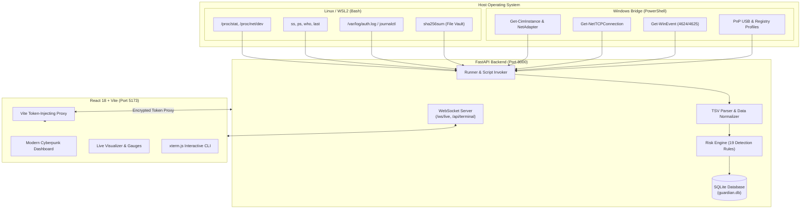

# 🛡️ Smart OS Guardian

<p align="center">
  <b>Next-Generation Real-Time Security Monitoring & Host Intrusion Detection Dashboard</b><br>
  <i>Built with FastAPI, React, Vite, SQLite, and Native OS Collectors (Linux Bash + Windows PowerShell Bridge)</i>
</p>

<p align="center">
  
  
  
  
  
  
</p>

---

## 📌 Overview

**Smart OS Guardian** is a robust, lightweight security monitoring system and intrusion detection dashboard designed for both **Linux (native or WSL2)** and **Windows** systems.

Unlike traditional mock-up security panels, **Smart OS Guardian operates strictly on 100% REAL system data**:
- **Zero Mock Data**: Reads live kernel metrics, network sockets, running processes, Windows Event Logs, `/var/log/auth.log`, and hardware buses.
- **Read-Only Collectors**: Collectors strictly **READ** the host system without making unintended state modifications.
- **Micro-Footprint**: Stores state locally in a contained SQLite database (`data/guardian.db`) and user watchlists (`data/watchlist.user.conf`).

---

## 🚀 Key Features

- 🎨 **Modern GNOME/Ubuntu Design System**: Clean, user-friendly desktop aesthetic inspired by modern Ubuntu and GNOME, featuring both Light (Yaru-inspired) and Dark themes alongside Tokyo Night and Nord options.
- ⚡ **Real-Time Live Telemetry (WebSockets)**: Continuous sub-second CPU, multi-core utilization, RAM consumption, and network RX/TX bandwidth throughput. Supports **Both Mode** showing Linux & Windows metrics side-by-side.
- 🧭 **Real Port Geometry Radar**: Sockets mapped by port range (Inner: <1024 system ports, Mid: registered, Outer: dynamic) and protocol angle.
- 🛡️ **Dynamic Service Health Auditing**: Real-time `/api/health` monitoring with latency diagnostics.
- 🔍 **Process & Binary Inspection**: Real-time process tree analysis, CPU/RAM usage tracking, detection of deleted binaries running in memory, and execution out of `/tmp` or temp directories.
- 🌐 **Network Socket Auditing**: Active listening ports, established remote connections, and baseline comparison alerting on newly opened backdoors or unusual public IPs.
- 🔑 **Authentication & Privilege Tracking**:
  - **Linux**: Inspects `/var/log/auth.log` or `journalctl` for SSH brute force attempts, sudo usage, `su` privilege escalations, and interactive sessions.
  - **Windows**: Queries the Windows Security Event Log (Event IDs `4624`, `4625`) and `quser` interactive sessions.
- 📂 **Cryptographic File Vault**: Monitors critical configuration files (`/etc/passwd`, `/etc/sudoers`, hosts, SSH authorized keys, PowerShell profiles) using SHA-256 baseline hashing.
- 🔌 **Hardware & USB Bus Monitor**: Real-time detection of inserted USB flash drives, HID bad-USB devices, and peripheral hardware changes.
- 🧠 **Smart Risk Engine**: 19 rule-based behavioral threat analyzers calculating real-time host vulnerability scores (`SAFE`, `LOW`, `MEDIUM`, `HIGH`, `CRITICAL`).
- 🔔 **Live Alert Push & MITRE ATT&CK Drawer**: Real-time alert polling, toast notifications for threats, and clickable MITRE ATT&CK technique references.
- 📋 **Table Usability & Filtering**: Client-side full-text search, multi-column sorting, friendly readable headers, and pagination across all modules.
- 💻 **Sandboxed Command Terminal**: Built-in xterm.js terminal with tab auto-completion, command history, output clipboard copy, and whitelisted commands (`guardian status`, `guardian procs`, `guardian top`, `guardian timeline`, etc.).
- 🎯 **Interactive Demonstration & Defense Lab**: Interactive live proof panel allowing testers and supervisors to simulate events and verify threat alerts in seconds.
- ⚙️ **Settings & Custom Watchlist**: Manage theme, refresh intervals, and add custom filesystem paths to the File Vault directly from the UI.
- 👥 **Team Presentation / Viva Defense Page**: Interactive team portfolio featuring member roles, module ownership, and defense talking points.
- 📊 **Multi-Format Security Reports**: One-click instant reports exported in **HTML**, **plain text**, or structured **JSON**.

---

## 🏗️ Architecture



---

## 🛠️ Quick Start

### Option A: Windows (Native One-Click)

1. **Prerequisites**:
   - Python 3.10+ (with `fastapi`, `uvicorn`, `psutil`)
   - Node.js 18+ & Git for Windows

2. **Launch**:
   Double click `start.bat` or run:
   ```cmd
   start.bat
   ```
   Or launch via `launch.bat` (automatically detects WSL2 if available, otherwise runs Windows native):
   ```cmd
   launch.bat
   ```
   The dashboard will automatically open at **`http://localhost:5173`**!

---

### Option B: Linux or WSL2 (Ubuntu 20.04 / 22.04 / 24.04)

1. **Install dependencies**:
   ```bash
   sudo apt update && sudo apt install -y python3 python3-venv python3-pip sqlite3 git
   ```

2. **Setup and Start**:
   ```bash
   ./setup.sh
   ./start.sh
   ```

3. Open **`http://localhost:5173`** in your browser.

---

## 🧪 Testing & Verification

The project includes automated test suites covering backend rules, APIs, collector contracts, and frontend components:

### Backend Unit & Integration Tests:
```bash
python -m pytest tests/backend
```

### Collector Contract Verification:
```bash
bash tests/bash/test_contract.sh
```

### Frontend Lint & Vitest:
```bash
cd frontend
npm run lint
npm test
npm run build
```

---

## 🔒 Security & Authentication

- **Zero-Exposure API Token**: When launched via `start.sh` or `start.bat`, a cryptographic random token (`GUARDIAN_TOKEN`) is generated. The Vite proxy securely injects this token as `X-Guardian-Token` so the browser never exposes credentials.
- **Command Injection Prevention**: Collector scripts and watchlist paths are strictly validated through regex and absolute filesystem checks; no user input is ever concatenated into shell commands.

---

## 📁 Repository Structure

```
smart-os-guardian/
├── backend/
│   ├── app/              # FastAPI application, routes, websockets & parsers
│   ├── database/         # SQLite schema, connection management & history
│   └── risk/             # Threat detection rules and risk scoring engine
├── frontend/
│   ├── src/
│   │   ├── components/   # UI widgets, Radar and Cyberpunk styling
│   │   ├── hooks/        # Live WebSocket & scan hooks
│   │   ├── pages/        # Overview, Network, Process, Auth, Vault, Terminal...
│   │   └── theme/        # CSS variables & dark/cyber themes
│   └── package.json
├── bash/
│   ├── linux/            # Native Linux bash collectors
│   ├── windows-bridge/   # Windows PowerShell collector bridge
│   ├── common/           # Shared watchlist, quser parser & libraries
│   └── demo/             # Harmless red-team demo attack scripts
├── tests/
│   ├── backend/          # Pytest backend test suite
│   ├── frontend/         # Vitest component & page tests
│   ├── bash/             # Collector contract testing script
│   └── fixtures/         # Sample logs & test fixtures
├── launch.bat            # Windows auto-detection launcher
├── start.bat             # Windows native launcher
├── start.sh              # Linux / WSL2 launcher
├── setup.sh              # Linux / WSL2 setup script
└── README.md             # Documentation
```

---

## 📄 License

This project is open-source under the [MIT License](LICENSE).
